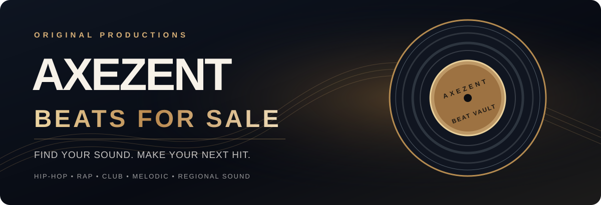

# AXEZENT BEATS FOR SALE
**Find Your Sound. Make Your Next Hit.**

[**🎧 ADD 50 PLAYABLE MP3 PREVIEWS**](docs/ACTIVATE_50_PLAY_BUTTONS.md) &nbsp;·&nbsp; [**🌐 PUBLISH WEBSITE**](https://app.netlify.com/start) &nbsp;·&nbsp; [**TRACK CATALOG**](data/catalog.json)

---

### THE SOUND. THE CULTURE. THE ARTIST.

Rap beats. Hip-hop instrumentals. Southern bass, Detroit bounce, New York energy, West Coast grooves, and original sounds from cities across America.

**The music-store website is designed.** The 200 original track concepts are being produced and mastered one by one. Listen and buy features will appear as real recordings become ready and payment processing is connected.

### OPEN THE ACTUAL WEBSITE

The customer-facing website is **not inside GitHub's file viewer**. GitHub hosts the source code; the finished site needs its own public web address.

[**Publish AXEZENT Beats for Sale from this GitHub repository →**](https://app.netlify.com/start)

On Netlify: **Import an existing project → GitHub → `shawncalvinsnelling/AXEZENT-Beats-for-Sale` → Deploy**. Keep the **publish directory** as `.` and leave the build command empty. Make the site public in Netlify's settings if it starts private.

After publishing, copy the actual `https://...netlify.app` website address into the repository's **About → Website** field. Then GitHub will display a direct one-click link to the real storefront. You can use a custom domain later.

<strong>Store details and release safeguards</strong>

- **200** unique original titles across **50** states, searchable by city, title and broad region.
- Proposed **$100 nonexclusive commercial beat license**, subject to approved terms. A license is not a full copyright buyout.
- Only real, tagged MP3 previews may be publicly playable. As of this commit **no finished beat audio is uploaded**.
- Private masters, stems, payment credentials, and buyer records must never go into this public repository.
- Sales and paid downloads remain disabled until signed payment verification, license agreements and protected delivery are ready.
- See [one-by-one release procedure](docs/RELEASE_WORKFLOW.md).
- [Track catalog](data/catalog.json) · [First beat production task](https://github.com/shawncalvinsnelling/AXEZENT-Beats-for-Sale/issues/1).

**Copyright:** AXEZENT. The public repository does not grant a license to exploit, resell, or redistribute the music. Software use permissions are not granted until a separate code license is chosen.

